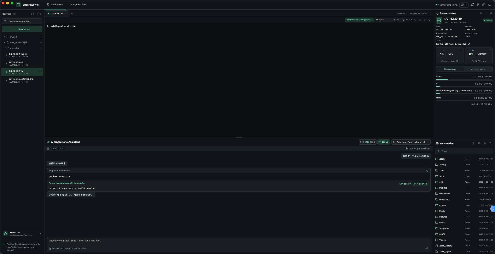

# SparrowShell

**[中文](README.md) · English**

SparrowShell is a local-first server management tool with AI-assisted operations. It brings an SSH terminal, remote file management, server monitoring, and batch operations into one workspace, with support for macOS and Windows.

You can manage servers without creating an account. Server passwords and private-key passphrases remain on the local device and are never synchronized to the cloud. AI-generated commands run through a local execution policy with three modes: confirm every command, confirm high-risk commands only, or run all commands automatically.



## Features

- **Server connection management**: Organize servers into nested folders and connect using passwords, private keys, or jump hosts.
- **SSH terminal**: Use multiple terminal tabs, command history, command suggestions, common command completion, and batch execution.
- **Remote file management**: Browse, upload, download, rename, move, and extract remote files, with text editing, syntax highlighting, and search and replace.
- **Server monitoring**: Inspect system information, CPU, memory, disks, and processes, with explicit confirmation before terminating a process.
- **AI operations assistant**: Generate commands from natural language, inspect actual execution results, continue analysis, and control which local context categories may be shared.
- **Batch operations and automation**: Run operations across multiple servers and define automated workflows.
- **Local first with optional cloud sync**: Use the app without signing in, or synchronize server configurations across devices after signing in. Secrets are never synchronized.
- **Personalization**: Choose dark or light themes, configure terminal fonts, and switch between Chinese and English interfaces.

> **Safety warning:** “Run all commands automatically” does not ask for additional confirmation and may execute destructive or high-risk operations, including deletion or shutdown. Use it only on trusted servers and in environments where you have explicit authorization.

## Repository layout

```text
sparrowshell/
├── apps/
│   ├── desktop/
│   │   ├── mac/             # macOS client and standalone Rust workspace
│   │   └── windows/         # Windows client and standalone Rust workspace
│   └── admin/               # Optional web admin console
├── services/
│   └── sparrowshell-ai/     # Shared Java backend for both clients
├── deploy/
│   ├── mysql/init.sql       # One-shot initialization for a new database
│   └── docker/              # Docker build and deployment examples
├── tests/openssh/           # Isolated OpenSSH integration environment
├── docs/                    # Build guides, platform documentation, and screenshots
└── SECURITY.md              # Security reporting guidelines
```

## Technology stack

- **Clients**: Tauri 2, Rust, React, TypeScript, Vite, xterm.js, CodeMirror, and SQLite.
- **Backend**: Java 8, Spring Boot 2.7, JDBC, and MySQL 5.7.
- **Admin console**: React, Vite, and Nginx.
- **Optional integrations**: Qwen, DeepSeek, SMTP / Tencent Cloud SES, and Alipay.

## Two ways to use SparrowShell

### 1. Client with the basic AI service

Deploy only the client and basic backend, then configure your own model credentials to use AI. You do not need the admin console, payments, email, accounts, or database-backed platform capabilities.

### 2. Complete self-hosted platform

Add MySQL to the basic service and enable accounts, cloud sync, feedback, version updates, email, and the admin console as needed. Payments and subscriptions are independently optional; keep them disabled if you do not charge users.

## Quick start

### Requirements

- Node.js 20 or later;
- Rust stable, managed through `rust-toolchain.toml`;
- Java 8 and Maven 3.8 or later;
- MySQL 5.7 for the complete platform;
- Xcode Command Line Tools for macOS builds;
- Visual Studio C++ Build Tools, WebView2, and the NASM required by Rust dependencies for Windows builds.

### Run the macOS client

```bash
cd apps/desktop/mac
npm ci
npm run tauri dev
```

### Run the Windows client

Run the following in PowerShell on Windows 10/11 x64:

```powershell
cd apps/desktop/windows
npm ci
npm run tauri dev
```

The Windows source includes DPAPI, native menu, update target, and NSIS adaptations. Native compilation, installation, and runtime behavior should still be validated on Windows. See `docs/Windows开源客户端适配与构建指南.md` for the complete guide.

### Run only the web interface

```bash
cd apps/desktop/mac
npm run dev
```

The web preview does not replace native client validation. SSH, SFTP, and operating-system credential storage require Tauri.

## Configure the client backend URL

AI, accounts, cloud sync, usage quotas, version updates, and feedback share one backend URL. Configure each client independently by editing the file in its project root:

- macOS: `apps/desktop/mac/config.example.json`
- Windows: `apps/desktop/windows/config.example.json`

```json
{
  "apiBaseUrl": "http://127.0.0.1:8070"
}
```

**Do not copy or rename the configuration file.** It is embedded into the application at build time, so development and release builds use the same backend URL. Restart the development client or rebuild the application after changing it.

HTTP is allowed for a loopback backend; non-local backends must use HTTPS. Do not place model credentials, server passwords, login tokens, or payment secrets in this file. The client connects only to an already running backend and does not start the backend process itself.

## Start the basic AI backend

Go to the backend directory and copy the Qwen configuration example:

```bash
cd services/sparrowshell-ai
cp config/application.properties.example config/application.properties
```

In Windows PowerShell, use:

```powershell
Copy-Item config/application.properties.example config/application.properties
```

Edit `services/sparrowshell-ai/config/application.properties` and enter your own Bailian API key and application ID:

```properties
sparrowshell.qwen.api-key=your-bailian-api-key
sparrowshell.qwen.app-id=your-bailian-application-id
sparrowshell.qwen.model=qwen3.8-flash
```

The `api-key` is the API key from Alibaba Cloud Bailian. The `app-id` is the ID of an application you have created in Bailian, not a model name. The real `application.properties` file is ignored by Git; do not commit it to a public repository.

Save the file and start the backend directly. No environment variables are required for Qwen:

```bash
mvn spring-boot:run
```

The backend listens on `http://127.0.0.1:8070` by default. The dynamic agent uses a Qwen application; DeepSeek can be used by the corresponding static command-generation route. If no model is configured, the client reports that the backend model is unavailable.

Keep database, email, payment, and platform persistence features disabled in basic mode. Accounts, cloud sync, release management, persistent feedback, and admin data capabilities require the complete platform configuration.

## Complete deployment and admin console

For a new deployment, run `deploy/mysql/init.sql` once to create the database and all tables. Do not run it again against an existing business database. The backend does not execute the initialization SQL automatically at startup.

For database settings, environment variables, administrator bootstrap, Docker images, and container startup, see:

- `deploy/docker/README.md`
- `deploy/docker/server/sparrowshell.env.example`

The admin console is optional. Start it only when you deploy the complete platform and need graphical administration:

```bash
cd apps/admin
npm ci
npm run dev
```

The development server proxies `/v1` to `http://127.0.0.1:8070`. Creating the first administrator requires temporarily enabling the backend administrator bootstrap; see `deploy/docker/README.md`. The admin console contains no fixed demo account. Administrators are created by the person deploying the service.

## Tests

Run the following in either the macOS or Windows client project:

```bash
npm test
npm run build
cargo test --workspace
```

Backend:

```bash
cd services/sparrowshell-ai
mvn test
```

Admin browser tests use mocked APIs and do not connect to a real backend:

```bash
cd apps/admin
npx playwright install chromium
npm run test:ui
```

OpenSSH integration tests use Docker and bind only to the loopback interface. Run these commands from the macOS client project:

```bash
cd apps/desktop/mac
docker compose -f ../../../tests/openssh/compose.yml up -d --build --wait
cargo test -p sparrowshell-ssh-core --test openssh -- --ignored --nocapture
docker compose -f ../../../tests/openssh/compose.yml down -v
```

## Build

macOS client:

```bash
cd apps/desktop/mac
npm run tauri build
```

Windows x64 NSIS installer:

```powershell
cd apps/desktop/windows
npm run tauri build -- --bundles nsis --target x86_64-pc-windows-msvc
```

Backend:

```bash
cd services/sparrowshell-ai
mvn clean package
```

Admin console:

```bash
cd apps/admin
npm run build
```

This repository does not include personal or corporate signing identities. Configure code signing in your own build environment for public releases. Keep macOS notarization credentials and Windows Authenticode certificates on your local machine or in CI secret storage; never commit them to the repository.

## Security and privacy

- Qwen credentials are stored only in the backend's Git-ignored local configuration file; database, email, administrator, license, and payment secrets are configured through the deployment environment.
- Server passwords, private-key passphrases, and account secrets are never included in cloud synchronization.
- Email, platform persistence, background jobs, administrator bootstrap, and real payments are disabled by default.
- Keep `SPARROWSHELL_PAYMENT_CHANNEL=disabled` when payments are not needed.
- Open-sourcing the admin console does not make it safe to expose management APIs without protection. Use HTTPS in production and consider an IP allowlist or VPN.
- Never commit server passwords, private keys, access tokens, real server configurations, database exports, or user data.
- Report security issues privately according to `SECURITY.md`; do not disclose sensitive details in public issues.

## Contact the author

If you encounter a problem while using, deploying, or extending SparrowShell, contact the author by email: [362053214@qq.com](mailto:362053214@qq.com).

## License

This project is licensed under the [MIT License](LICENSE).
