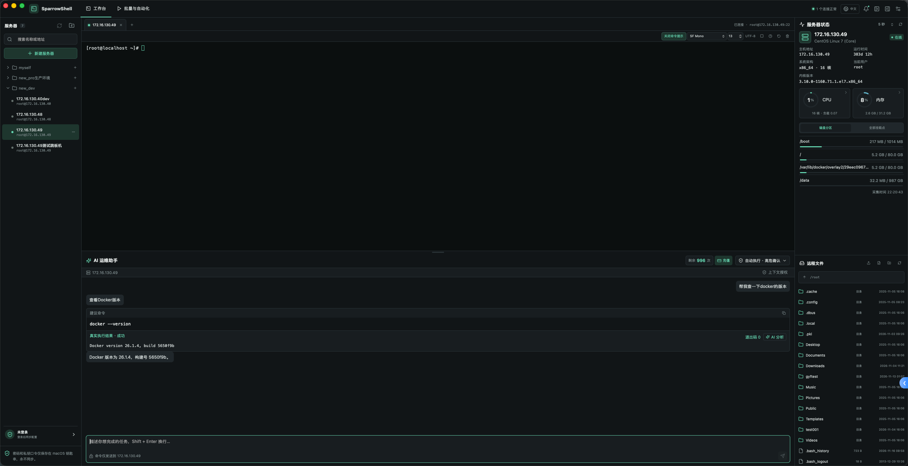

# SparrowShell

**中文 · [English](README.en.md)**

SparrowShell 是一款本地优先、支持 AI 辅助运维的服务器管理工具，将 SSH 终端、远程文件管理、服务器监控和批量操作整合在同一个工作台中，支持 macOS 与 Windows。

无需注册即可管理服务器。服务器密码和私钥口令仅保存在本机，不参与云同步；AI 生成的命令通过本地执行策略运行，支持逐条确认、高危命令确认和完全自动执行三种模式。



## 核心功能

- **服务器连接管理**：使用文件夹和子文件夹整理服务器，支持密码、私钥和跳板机连接。
- **SSH 终端**：支持多标签终端、历史命令、命令提示、常用命令补全和批量执行。
- **远程文件管理**：浏览、上传、下载、重命名、移动和解压远程文件，支持文本编辑、语法高亮及搜索替换。
- **服务器监控**：查看系统信息、CPU、内存、磁盘和进程，支持经确认后终止指定进程。
- **AI 运维助手**：通过自然语言生成命令、查看实际执行结果并继续分析，支持本地上下文权限控制。
- **批量与自动化**：支持多服务器批量操作和自动化工作流定义。
- **本地优先与可选云同步**：不登录也能使用；登录后可在不同设备之间同步服务器配置，秘密信息不同步。
- **个性化设置**：支持深色／浅色主题、终端字体设置和中英文界面。

> **安全提示：**“自动执行所有命令”不会要求额外确认，也可能直接执行删除、停机等高危操作。请仅在可信服务器和明确授权的环境中使用。

## 仓库结构

```text
sparrowshell/
├── apps/
│   ├── desktop/
│   │   ├── mac/             # macOS 客户端及独立 Rust 工作区
│   │   └── windows/         # Windows 客户端及独立 Rust 工作区
│   └── admin/               # 可选的 Web 管理端
├── services/
│   └── sparrowshell-ai/     # 两端共用的 Java 后台服务
├── deploy/
│   ├── mysql/init.sql       # 全新数据库的一键初始化脚本
│   └── docker/              # Docker 构建和部署示例
├── tests/openssh/           # 隔离的 OpenSSH 集成测试环境
├── docs/                    # 构建、平台适配文档和界面截图
└── SECURITY.md              # 安全问题反馈说明
```

## 技术栈

- **客户端**：Tauri 2、Rust、React、TypeScript、Vite、xterm.js、CodeMirror、SQLite。
- **后台服务**：Java 8、Spring Boot 2.7、JDBC、MySQL 5.7。
- **管理端**：React、Vite、Nginx。
- **可选集成**：通义千问、DeepSeek、SMTP／腾讯云 SES、支付宝。

## 两种使用方式

### 1. 客户端与 AI 基础服务

只部署客户端和后台基础服务，配置自己的模型密钥即可使用 AI。无需启动管理端，也无需启用支付、邮件、账号和数据库平台能力。

### 2. 完整自托管平台

在基础服务之上配置 MySQL，并按需启用账号、云同步、反馈、版本更新、邮件和管理端。支付与订阅是独立可选能力，不需要收费时保持关闭。

## 快速开始

### 环境要求

- Node.js 20 或更高版本；
- Rust stable，由 `rust-toolchain.toml` 管理；
- Java 8 和 Maven 3.8 或更高版本；
- 完整平台需要 MySQL 5.7；
- macOS 构建需要 Xcode Command Line Tools；
- Windows 构建需要 Visual Studio C++ Build Tools、WebView2，以及 Rust 依赖构建所需的 NASM。

### 启动 macOS 客户端

```bash
cd apps/desktop/mac
npm ci
npm run tauri dev
```

### 启动 Windows 客户端

在 Windows 10／11 x64 的 PowerShell 中执行：

```powershell
cd apps/desktop/windows
npm ci
npm run tauri dev
```

Windows 的 DPAPI、本机菜单、更新目标和 NSIS 配置已完成代码适配；原生编译、安装和运行仍应在 Windows 环境中验收。完整说明见 `docs/Windows开源客户端适配与构建指南.md`。

### 仅启动 Web 界面

```bash
cd apps/desktop/mac
npm run dev
```

Web 预览不能替代原生客户端验证，SSH、SFTP 和系统存储等功能需要通过 Tauri 运行。

## 配置客户端后台地址

AI、账号、云同步、额度、版本更新和问题反馈共用同一个后台地址。每个客户端独立配置，直接修改对应工程根目录的文件：

- macOS：`apps/desktop/mac/config.example.json`
- Windows：`apps/desktop/windows/config.example.json`

```json
{
  "apiBaseUrl": "http://127.0.0.1:8070"
}
```

**不需要复制或重命名配置文件。** 这份配置会在编译时嵌入应用，开发模式和正式安装包使用同一个后台地址。修改后需要重新启动开发客户端或重新打包。

本机后台可以使用 HTTP；非本机后台必须使用 HTTPS。不要在配置中写入模型密钥、服务器密码、登录令牌或支付私钥。客户端只连接已经启动的后台，不会自动启动后台进程。

## 启动 AI 基础后台

进入后台目录，复制通义千问配置示例：

```bash
cd services/sparrowshell-ai
cp config/application.properties.example config/application.properties
```

Windows PowerShell 可使用：

```powershell
Copy-Item config/application.properties.example config/application.properties
```

编辑 `services/sparrowshell-ai/config/application.properties`，填写自己的百炼 API-Key 和应用 ID：

```properties
sparrowshell.qwen.api-key=你的百炼API-Key
sparrowshell.qwen.app-id=你的百炼应用ID
sparrowshell.qwen.model=qwen3.8-flash
```

其中，`api-key` 是阿里云百炼平台的 API-Key，`app-id` 是已创建百炼应用的应用 ID，不是模型名称。真实的 `application.properties` 已被 Git 忽略，不要提交到公开仓库。

保存后直接启动后台，不需要设置环境变量：

```bash
mvn spring-boot:run
```

后台默认监听 `http://127.0.0.1:8070`。动态 Agent 使用通义千问应用；DeepSeek 可用于相应的静态命令生成路由。没有配置模型时，客户端会明确提示后台模型未配置。

基础模式保持数据库、邮件、支付和平台持久化开关关闭即可。账号、云同步、版本管理、反馈持久化和管理端数据能力需要完整平台配置。

## 完整部署与管理端

全新部署执行一次 `deploy/mysql/init.sql` 即可创建数据库和全部数据表，不要在已有业务数据库上重复执行。后台启动时不会自动执行初始化 SQL。

数据库、环境变量、管理员引导、Docker 镜像和容器启动说明见：

- `deploy/docker/README.md`
- `deploy/docker/server/sparrowshell.env.example`

管理端是可选组件，只有部署完整平台并需要图形化管理时才启动：

```bash
cd apps/admin
npm ci
npm run dev
```

开发服务器将 `/v1` 代理到 `http://127.0.0.1:8070`。首次创建管理员需要临时启用后台管理员引导，具体步骤见 `deploy/docker/README.md`。管理端不包含固定演示账号，真实账号由部署者创建。

## 测试

macOS 或 Windows 客户端均可在各自工程目录执行：

```bash
npm test
npm run build
cargo test --workspace
```

后台服务：

```bash
cd services/sparrowshell-ai
mvn test
```

管理端浏览器测试使用模拟 API，不连接真实后台：

```bash
cd apps/admin
npx playwright install chromium
npm run test:ui
```

OpenSSH 集成测试使用 Docker，仅绑定本机回环地址。以下命令从 macOS 客户端工程目录执行：

```bash
cd apps/desktop/mac
docker compose -f ../../../tests/openssh/compose.yml up -d --build --wait
cargo test -p sparrowshell-ssh-core --test openssh -- --ignored --nocapture
docker compose -f ../../../tests/openssh/compose.yml down -v
```

## 构建

macOS 客户端：

```bash
cd apps/desktop/mac
npm run tauri build
```

Windows x64 NSIS 安装包：

```powershell
cd apps/desktop/windows
npm run tauri build -- --bundles nsis --target x86_64-pc-windows-msvc
```

后台服务：

```bash
cd services/sparrowshell-ai
mvn clean package
```

管理端：

```bash
cd apps/admin
npm run build
```

本仓库不包含个人或公司的签名身份。正式发布客户端时，请在自己的构建环境中配置代码签名；macOS 公证凭据和 Windows Authenticode 证书应保存在本机或 CI 密钥管理中，不要提交到仓库。

## 安全与隐私

- 通义千问密钥只填写在被 Git 忽略的后台本地配置文件中；数据库、邮箱、管理员、许可证和支付密钥通过部署环境配置。
- 服务器密码、私钥口令和账号秘密不参与云同步。
- 邮件、平台持久化、后台任务、管理员引导和真实支付默认关闭。
- 不需要支付时保持 `SPARROWSHELL_PAYMENT_CHANNEL=disabled`。
- 管理端代码开源不代表管理接口可以无保护地暴露到公网；生产环境应使用 HTTPS，并建议增加 IP 白名单或 VPN。
- 请勿提交服务器密码、私钥、访问令牌、真实服务器配置、数据库导出或用户数据。
- 安全问题请按照 `SECURITY.md` 私下反馈，不要在公开 Issue 中披露敏感细节。

## 联系作者

如果你在使用、部署或二次开发中遇到问题，可以通过邮件联系作者：[362053214@qq.com](mailto:362053214@qq.com)。

## 许可证

本项目采用 [MIT License](LICENSE)。
